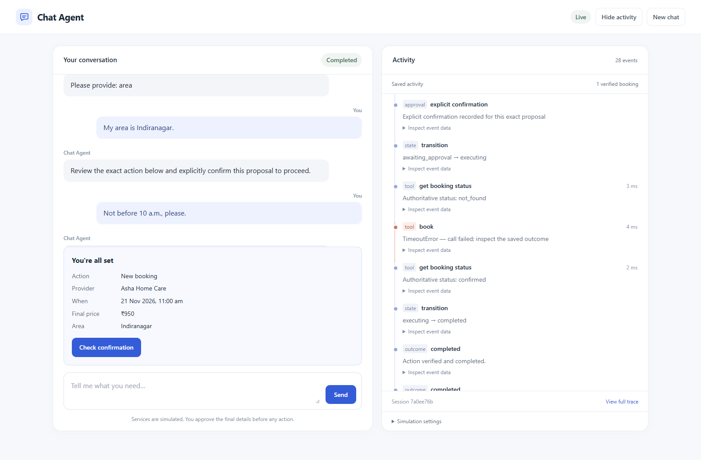
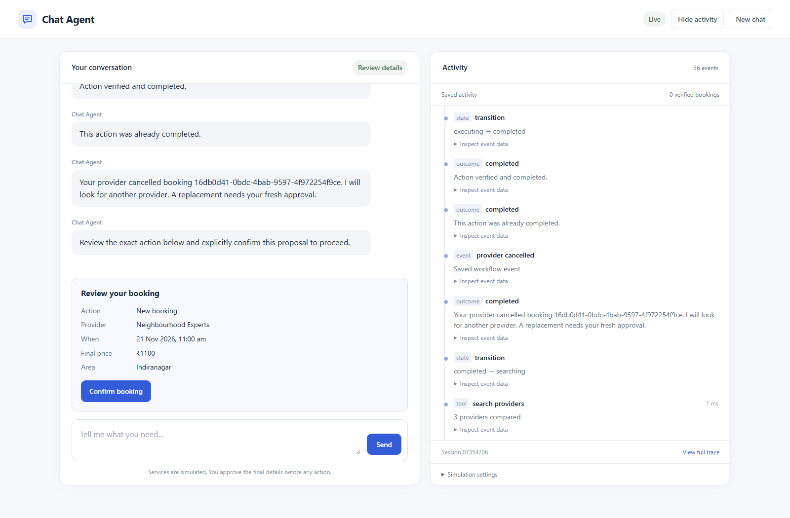
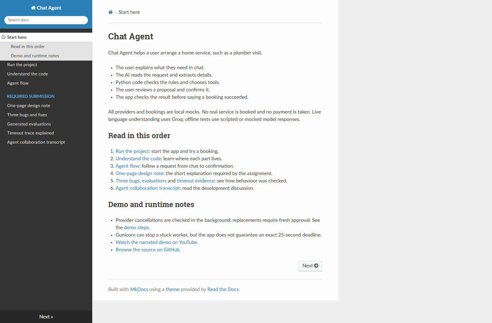
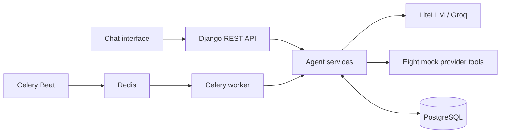

<div align="center">

# Chat Agent

**A home-service booking assistant with explicit approval and an inspectable trace.**

Describe a task. Review the options. Approve the exact booking.


[Watch the demo](#demo) · [Run locally](#quick-start) · [Open the docs](#documentation) · [Explore the code](#project-structure)

</div>

## Demo

[](https://youtu.be/dXzXla9keik)

**4 min 39 sec · 1080p · English narration**

[▶ Watch the demo on YouTube](https://youtu.be/dXzXla9keik)

The walkthrough shows a real-model conversation, a corrected time window, exact approval, timeout-after-success recovery, saved memory, project structure, and a provider cancellation that produces a fresh proposal.

> Providers, bookings and payments are local simulations. Natural-language understanding uses a real LLM; automated evaluations run offline.

## What it does

| Capability | Behaviour |
|---|---|
| **Conversational requests** | Collects missing service, area, date, time and budget details, and preserves unrelated facts when one detail changes. |
| **Explicit approval** | Booking, cancellation and rescheduling require confirmation of a saved proposal and its exact details. |
| **Safe recovery** | Checks authoritative booking status after a timeout and reuses the same idempotency key instead of blindly booking again. |
| **Background follow-up** | Detects simulated provider cancellations, notifies the user and proposes a different provider for fresh approval. |
| **Editable memory** | Lets users inspect, correct and forget explicit preferences. |
| **Visible evidence** | Saves state changes, model/tool calls, sanitized results, latency, token usage and cost estimates where available. |

### A cancellation becomes a new decision



The background worker can search for a replacement. It cannot approve the replacement on the user's behalf.

## Quick start

**You need:** Git and Docker Desktop with Linux containers running.

```bash
git clone https://github.com/harshshahdev111-cell/wrxtcchtdg.git
cd wrxtcchtdg
cp .env.example .env
docker compose up --build -d --wait
```

`cp` also works in PowerShell. If you already have a configured `.env`, keep it instead of copying the example again.

| Open | Address |
|---|---|
| Chat interface | [localhost:8001](http://127.0.0.1:8001/) |
| Browsable REST API | [Conversations](http://127.0.0.1:8001/api/v1/conversations/) |
| Health and model mode | [Health endpoint](http://127.0.0.1:8001/api/v1/health/) |

Compose starts the API, PostgreSQL, Redis, a Celery worker and one Beat scheduler. It runs database migrations before starting the server. PostgreSQL data stays in a named volume.

### Choose how to chat

**Live mode — normal English**

Edit `.env` with your provider key:

```dotenv
LLM_BACKEND=live
LLM_MODEL=groq/openai/gpt-oss-20b
LLM_API_KEY=your-provider-key
LLM_BASE_URL=
```

Then reload the backend configuration:

```bash
docker compose up -d --force-recreate backend worker
```

Try: **“Find a plumber in Indiranagar tomorrow between 10 a.m. and noon, under ₹1,500.”** Review the proposal, then click **Confirm booking**.

**Offline mode — scripted JSON**

The example environment defaults to `LLM_BACKEND=demo`. Enter a JSON plan into the chat, such as:

```json
{"service":"plumber","area":"Indiranagar","budget":1500}
```

The agent asks for the missing date range. Supply two real future dates as `date_range`, then review the proposal. Offline mode is for repeatable scenarios; it does not interpret English.

Keys stay on the backend. `.env` is ignored by Git.

## Documentation

The MkDocs site explains the project in simple language, with setup steps, code locations, design decisions and evaluation evidence.

**Start the docs separately from Docker** using Python 3.12+:

```powershell
python -m venv .venv
.\.venv\Scripts\python -m pip install -r requirements/development.txt
.\.venv\Scripts\python -m mkdocs serve
```

**Open [localhost:8002](http://127.0.0.1:8002/).** The app stays on port **8001**. On macOS/Linux, use `.venv/bin/python` instead of `.\.venv\Scripts\python`.

<details>
<summary><strong>Preview the documentation site</strong></summary>



</details>

You can also read these pages directly on GitHub:

| Guide | What you will find |
|---|---|
| [Run the project](docs/setup.md) | Docker, model settings, tests and cancellation demo steps |
| [Understand the code](docs/developer-guide.md) | File responsibilities, database tables and integration patterns |
| [Agent flow](docs/agent-flow.md) | Request, approval and recovery paths |
| [One-page design note](docs/design-note.md) · [PDF](docs/evidence/design-note.pdf) | State, approval, recovery, memory and observability |
| [Generated evaluations](docs/eval-results.md) | Actual scenario outcomes from the offline test run |
| [Timeout evidence](docs/timeout-trace.md) · [Raw JSON](docs/timeout-after-success.json) | A timeout-after-success run and its recovery |
| [Three bugs and fixes](docs/bugs.md) | Causes, fixes and regression tests |
| [Collaboration transcript](docs/transcript.md) | Edited development discussion |

Build the docs for sharing:

```powershell
.\.venv\Scripts\python -m mkdocs build --strict
```

The generated site is written to `site/` and excluded from Git.

## How it works



The model extracts request facts. Python selects tools and enforces approval. Provider reviews are untrusted data and cannot grant permission. The vendor factory keeps model and provider integrations separate from the booking rules.

AI network calls use async I/O and a shared HTTP pool. Short database transactions protect execution claims. Persistent keys, database constraints and status reconciliation protect booking retries.

## Project structure

```text
backend/
├── config/
│   ├── settings/           # base, development, production, test
│   ├── asgi.py             # Async web entry point
│   ├── celery.py           # Background task configuration
│   └── gunicorn.py         # Server workers and heartbeat timeout
├── chat_agent/
│   ├── api/v1/             # Validation, endpoints and routes
│   ├── services/           # Agent, approval, recovery, memory context and traces
│   ├── models.py           # Chats, proposals, memories and mock ledger
│   ├── tasks.py            # Periodic cancellation check
│   ├── tests/              # Offline scenarios and concurrency checks
│   └── templates/ + static/ # Chat interface
└── integrations/
    ├── factory.py          # Model and mock-provider selection
    ├── litellm/            # SDK calls and response decoding
    ├── llm/                # Prompts, validation and token counting
    └── providers/          # Reproducible mock tools
requirements/               # base, development, production packages
docs/                       # Guides, screenshots and evaluation evidence
compose.yaml                # Local services
```

## Test and inspect

Run the full Linux suite, including the ASGI server and PostgreSQL locking scenarios:

```bash
docker compose exec -T backend python manage.py test --settings=config.settings.test chat_agent.tests --noinput
```

The [checked-in evaluation table](docs/eval-results.md) records **135 passing scenarios**. Tests use scripted or mocked models and do not need an AI API key. See the [setup guide](docs/setup.md#4-run-tests) to regenerate the table. Run host and container suites one after the other because they share a test database.

To demonstrate background follow-up after confirming a booking:

```bash
docker compose exec -T backend python manage.py simulate_provider_cancellation BOOKING_ID
```

Use the booking ID from its trace. Leave the chat open: the scheduler checks every 10 seconds and the browser polls every 5 seconds while idle. The replacement still needs fresh approval.

<details>
<summary><strong>Useful Docker commands</strong></summary>

```bash
docker compose logs -f backend worker beat
docker compose stop
docker compose down
```

Stopping the stack preserves PostgreSQL data. `docker compose down -v` deletes its volumes.

</details>

## Scope

This is a local, unauthenticated prototype with simulated service providers. Keep it bound to localhost. Dates and appointment displays use **Asia/Kolkata**.

Async AI waits have deadlines, but arbitrary blocking code is not forcibly stopped. Hosted prompt formatting uses an explicit token allowance. See the [design note](docs/design-note.md) for the trade-offs.

---

<div align="center">made by idie dev</div>
