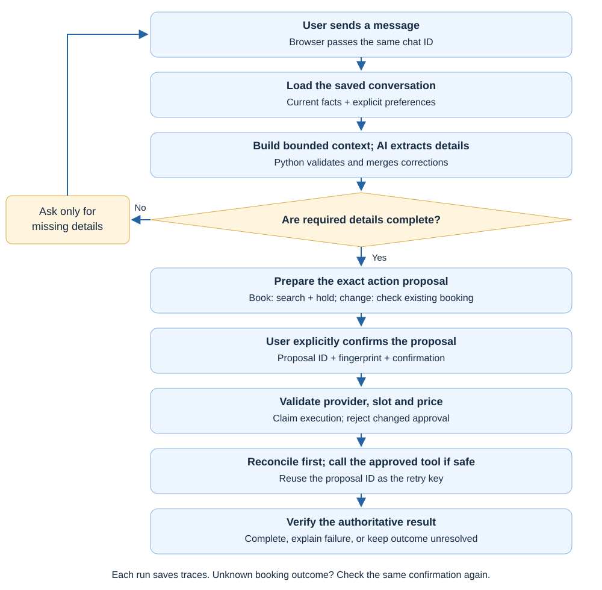

# Agent flow

## Read it in simple words

1. The browser sends the chat ID and the user's message.
2. Django loads the saved facts and explicit preferences.
3. The AI extracts new details. Python validates them and keeps unrelated facts.
4. Missing details are asked for; complete requests become a proposal.
5. The user reviews the exact action and explicitly confirms it.
6. Code checks provider, slot and price, and claims execution.
7. Recovery checks saved outcomes first. A write uses the same retry key.
8. Success is shown only after verification. Uncertain outcomes stay unresolved.

## The three action paths

- **Book:** compare providers, hold a slot, show the final quote, ask for approval.
- **Cancel:** load the user's booking, show the exact cancellation, ask for approval.
- **Reschedule:** load the booking, validate the proposed new slot, ask for approval.

A changed provider, slot or price requires fresh approval. Retrying a completed proposal returns its saved result.

The [original Mermaid source](assets/agent-flow.mmd) is included for editing. This page uses an SVG so the diagram works locally without an external JavaScript service.

## Background follow-up

1. A provider cancels a mock booking.
2. Beat schedules a check; a Celery worker detects the change without a chat prompt.
3. Save one cancellation notice. If another proposal is pending or executing, wait.
4. Search using the original request and current explicit preferences; exclude the cancelled provider.
5. Save a replacement proposal or explain that no replacement is ready.
6. The browser shows the update. Only fresh explicit approval can book the replacement.

The follow-up row and PostgreSQL lock prevent repeated checks from sending duplicate notices or proposals.

See [timeout evidence](timeout-trace.md) for an actual recovery run and [the code guide](developer-guide.md) for time-limit details.
